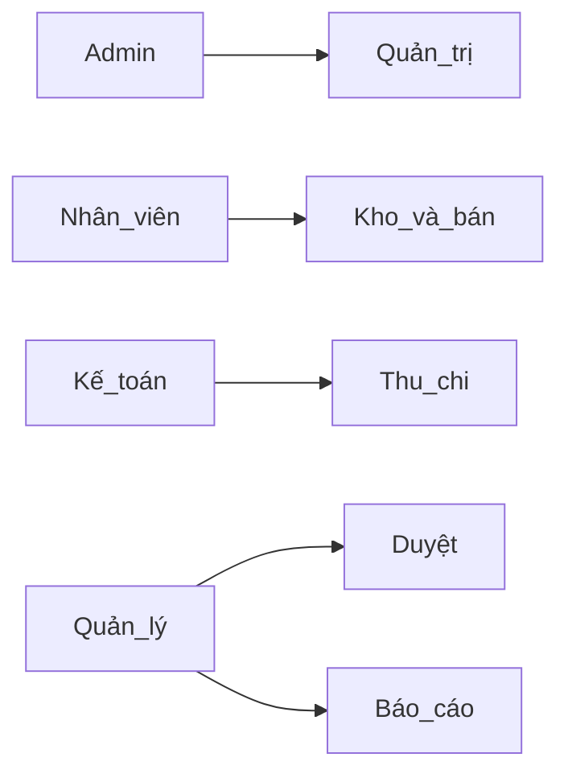
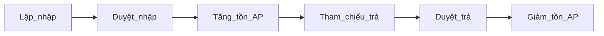
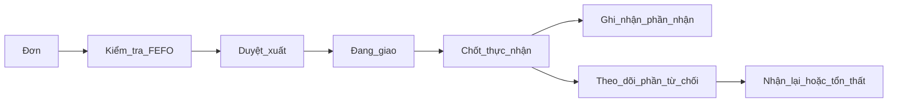
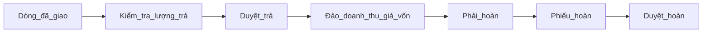
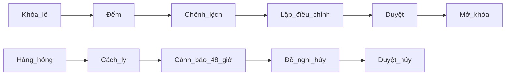
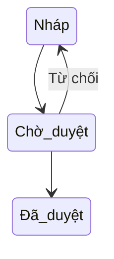
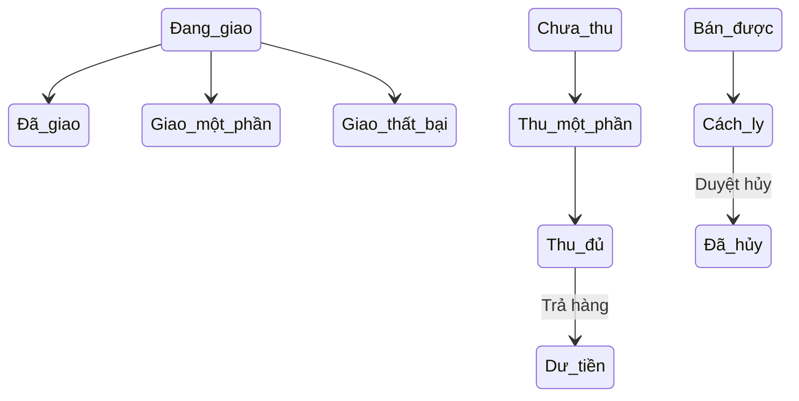
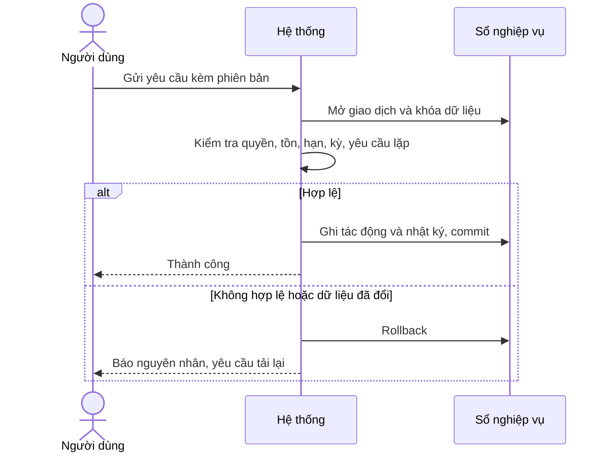
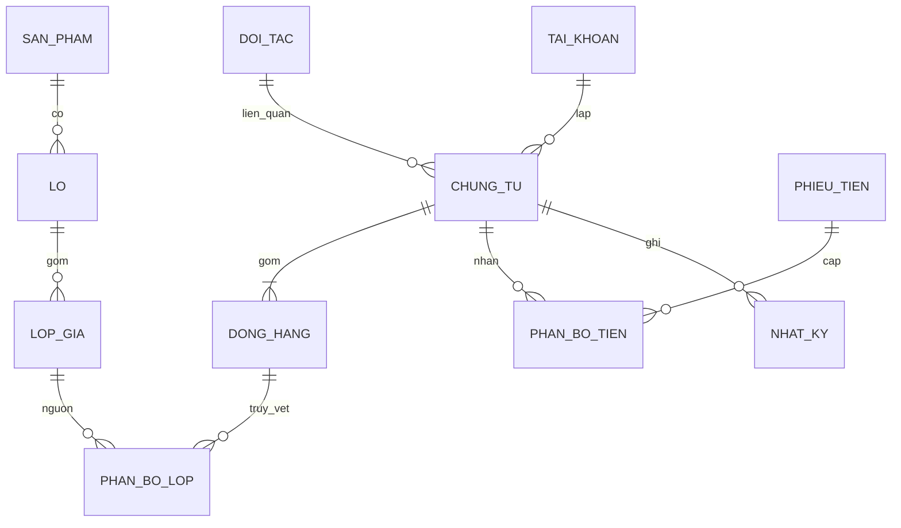

# ĐẶC TẢ YÊU CẦU PHẦN MỀM

**Hệ thống quản lý kho thực phẩm và kế toán nội bộ**

| Thuộc tính                   | Nội dung                                                 |
| ---------------------------- | -------------------------------------------------------- |
| Phiên bản                    | 2.0                                                      |
| Ngày cập nhật                | 03/11/2026                                               |
| Mục đích                     | Cơ sở phát triển, kiểm thử và nghiệm thu                 |
| Người sử dụng tài liệu       | Quản lý, kế toán, nhân viên, nhóm phát triển và kiểm thử |
| Ngôn ngữ / tiền tệ / múi giờ | Tiếng Việt / VND / Asia/Ho_Chi_Minh                      |

| Phiên bản | Thay đổi                                                     |
| --------- | ------------------------------------------------------------ |
| 1.1       | Đặc tả nghiệp vụ ban đầu                                     |
| 2.0       | Chuẩn hóa yêu cầu, chốt quy tắc, bổ sung mô hình và truy vết |

## Mục lục

1. [Giới thiệu](#1-giới-thiệu)
2. [Tác nhân và phân quyền](#2-tác-nhân-và-phân-quyền)
3. [Yêu cầu chức năng](#3-yêu-cầu-chức-năng)
4. [Quy tắc nghiệp vụ](#4-quy-tắc-nghiệp-vụ)
5. [Use case](#5-use-case)
6. [Mô hình và sơ đồ](#6-mô-hình-và-sơ-đồ)
7. [Dữ liệu và giao diện](#7-dữ-liệu-và-giao-diện)
8. [Phi chức năng và vận hành](#8-phi-chức-năng-và-vận-hành)
9. [Nghiệm thu và truy vết](#9-nghiệm-thu-và-truy-vết)

## 1. Giới thiệu

Hệ thống kiểm soát số lượng, chất lượng và giá trị thực phẩm theo lô; truy vết giao dịch, công nợ và kết quả kinh doanh nội bộ.

Phạm vi: một cửa hàng, một kho; nhập, xuất, giao, trả hàng, kiểm kê, cách ly, hủy, thu chi và khóa kỳ. Không bao gồm đa kho, kế toán kép, báo cáo thuế pháp định, hóa đơn điện tử hay API ngân hàng. Tài liệu mô tả yêu cầu nghiệp vụ, không quy định API hoặc cấu trúc lưu trữ vật lý.

| Thuật ngữ        | Ý nghĩa                                                  |
| ---------------- | -------------------------------------------------------- |
| Lô               | Nhóm hàng cùng mã lô, ngày sản xuất và hạn dùng          |
| Lớp giá          | Lần nhập có giá vốn riêng trong một lô                   |
| FEFO             | Ưu tiên lô hết hạn sớm; hòa thì ưu tiên lần nhập trước   |
| Ghi sổ           | Áp dụng tác động đã duyệt vào sổ nghiệp vụ               |
| AR / AP          | Phải thu khách hàng / phải trả nhà cung cấp              |
| Cách ly          | Trạng thái tồn không được phép bán                       |
| Chứng từ đối ứng | Chứng từ mới điều chỉnh tác động, giữ nguyên lịch sử gốc |

## 2. Tác nhân và phân quyền

| Thao tác                                      | Admin | Nhân viên | Kế toán | Quản lý |
| --------------------------------------------- | ----- | --------- | ------- | ------- |
| Tài khoản, cấu hình, phân quyền               | Có    | Không     | Không   | Không   |
| Lập/gửi chứng từ kho, bán, giao, trả, kiểm kê | Không | Có        | Không   | Có      |
| Lập/gửi thu chi, hoàn tiền, chi phí, đầu kỳ   | Không | Không     | Có      | Có      |
| Đề nghị khóa kỳ                               | Không | Không     | Có      | Có      |
| Duyệt/từ chối chứng từ, khóa/mở kỳ            | Không | Không     | Không   | Có      |
| Xem kho và bán hàng                           | Không | Có        | Có      | Có      |
| Xem giá vốn, công nợ, tài chính               | Không | Không     | Có      | Có      |
| Xem nhật ký toàn hệ thống                     | Có    | Không     | Không   | Có      |

Một tài khoản có thể kiêm nhiệm nhưng không được duyệt chứng từ do mình lập. Quyền được kiểm tra ở backend cho từng thao tác. Hệ thống thực hiện ghi sổ sau khi duyệt; người dùng không có thao tác ghi sổ tùy ý. Khóa tài khoản phải thu hồi phiên hiện tại.

## 3. Yêu cầu chức năng

Các quy tắc ở mục 4 có hiệu lực đối với toàn bộ yêu cầu. Mỗi yêu cầu bắt buộc có kịch bản nghiệm thu tại mục 9.

### 3.1 Danh mục và kho

| Mã   | Chức năng                           | Yêu cầu bắt buộc                                                                                                                                                                                                                                        |
| ---- | ----------------------------------- | ------------------------------------------------------------------------------------------------------------------------------------------------------------------------------------------------------------------------------------------------------- |
| FR01 | Quản trị hệ thống                   | Đăng nhập, đăng xuất, đổi mật khẩu, phân quyền. Hệ thống phải xác thực quyền (Authorization) tại tầng Backend cho mọi API request.                                                                                                                      |
| FR02 | Danh mục thực phẩm                  | Mã định danh duy nhất, tên, nhóm, đơn vị tính cơ sở (ĐVT), mức tồn tối thiểu, giá bán gợi ý, **tỷ lệ hao hụt tự nhiên cho phép (%)**, và trạng thái. Dữ liệu có phát sinh giao dịch chỉ được "Ngừng kích hoạt", tuyệt đối không xóa cứng (Hard delete). |
| FR03 | Quy đổi đơn vị                      | Khai báo ĐVT đóng gói và hệ số quy đổi dương về ĐVT cơ sở. Mọi chứng từ phải lưu trữ (snapshot) hệ số này tại thời điểm lập.                                                                                                                            |
| FR04 | Quản lý đối tác                     | Thông tin nhà cung cấp và khách hàng. Bắt buộc có hồ sơ định danh đầy đủ với khách hàng được phép mua nợ.                                                                                                                                               |
| FR05 | Quản lý Lô (Lot/Batch)              | Quản lý chi tiết theo thực phẩm, mã lô, ngày sản xuất, hạn sử dụng, và trạng thái chất lượng. Hệ thống sinh "Lớp giá nhập" (Price layer) riêng cho các lần nhập cùng mã lô để truy vết giá vốn đích danh.                                               |
| FR06 | Nhập kho (Inbound)                  | Lập phiếu nhập ghi nhận nhà cung cấp, lô, số lượng, đơn giá, chiết khấu và chi phí mua. Duyệt phiếu sẽ tự động tăng tồn kho và công nợ phải trả.                                                                                                        |
| FR07 | Cảnh báo tự động & FEFO             | Hệ thống đề xuất xuất kho theo nguyên tắc FEFO (First Expired, First Out). Cảnh báo tồn dưới ngưỡng, lô sắp hết hạn (mặc định 7 ngày). Lô quá hạn bị khóa không cho phép xuất bán.                                                                      |
| FR08 | Kiểm kê cuốn chiếu (Cycle Counting) | Kiểm kê theo lô hoặc nhóm hàng; khóa biến động trên lô đang đếm. Tự lập phiếu điều chỉnh; quản lý khác người lập phải duyệt. Thiếu vượt định mức bắt buộc giải trình.                                                                                   |
| FR09 | Quản lý Hàng cách ly (Quarantine)   | Hàng hỏng/trả về được tự động đưa vào kho "Cách ly". Hệ thống cảnh báo tự động yêu cầu lập phiếu Xuất hủy đối với hàng cách ly lưu trữ quá 48 giờ.                                                                                                      |
| FR10 | Xử lý tổn thất & Trả hàng NCC       | Lập phiếu xuất hủy (có ghi nhận giá trị tổn thất). Lập phiếu trả hàng NCC tham chiếu trực tiếp phiếu nhập cũ để ghi giảm tồn và giảm công nợ hợp lệ.                                                                                                    |
| FR11 | Báo cáo Kho                         | Trích xuất thẻ kho, tồn kho theo lô/date/trạng thái. Đảm bảo phương trình: Tồn cuối = Tồn đầu + Nhập − Xuất tuyệt đối khớp số liệu.                                                                                                                     |

### 3.2 Bán và giao hàng

| Mã   | Chức năng                                          | Yêu cầu bắt buộc                                                                                                                                                                                         |
| ---- | -------------------------------------------------- | -------------------------------------------------------------------------------------------------------------------------------------------------------------------------------------------------------- |
| FR12 | Đơn bán hàng                                       | Lưu thông tin khách, chi tiết dòng hàng, giảm giá (không vượt tiền hàng). Trạng thái thương mại bị khóa (Read-only) ngay khi phiếu xuất kho được duyệt.                                                  |
| FR13 | Trạng thái & Tiến trình                            | Tách bạch trạng thái vận đơn (nháp, chờ xuất, đang giao, đã giao, giao thất bại) và trạng thái thanh toán (chưa thu, thu một phần, thu đủ, dư tiền). Trạng thái được nội suy tự động từ dữ liệu thực tế. |
| FR14 | Xuất kho & Ghi nhận Đang giao                      | Duyệt phiếu xuất sẽ làm giảm "Tồn khả dụng" và tăng "Hàng đang giao". Giai đoạn này **chưa** ghi nhận Doanh thu và Giá vốn.                                                                              |
| FR15 | Rủi ro hết hạn trên đường giao (In-transit Expiry) | Kiểm tra hạn dùng tại mọi thao tác giao và bằng tác vụ nền đầu ngày. Hàng đang giao hết hạn chuyển giao thất bại do hết hạn; tiếp tục theo dõi hàng đang giao đến khi nhận lại hoặc duyệt tổn thất.      |
| FR16 | Xác nhận giao hàng (Thực nhận từng phần)           | Cho phép xác nhận số lượng thực nhận trên từng dòng hàng. Ghi nhận doanh thu thuần, giá vốn và phải thu theo đúng số lượng khách nhận.                                                                   |
| FR18 | Xử lý hoàn tiền                                    | Nếu khách trả hàng dẫn đến số tiền đã thu lớn hơn công nợ (phát sinh dư Có), hệ thống bắt buộc kế toán lập phiếu Hoàn tiền riêng biệt, quản lý duyệt. Không được tự ý xóa/sửa lịch sử phiếu thu cũ.      |
| FR19 | Bảo toàn dữ liệu                                   | Không cho phép sửa trực tiếp số lượng hoặc xóa bỏ đơn hàng/phiếu xuất đã ghi nhận xuất kho hoặc đã thu tiền. Mọi thay đổi phải thông qua "Chứng từ đối ứng" (Reversing entries).                         |

### 3.3 Kế toán nội bộ

| Mã   | Chức năng                       | Yêu cầu bắt buộc                                                                                                                                                                         |
| ---- | ------------------------------- | ---------------------------------------------------------------------------------------------------------------------------------------------------------------------------------------- |
| FR20 | Khai báo Đầu kỳ                 | Khai báo số dư theo lô, lớp giá, tiền mặt, tài khoản ngân hàng, công nợ. Duyệt 1 lần duy nhất khi đưa hệ thống vào vận hành.                                                             |
| FR21 | Thu Chi & Phân bổ               | Lập phiếu thu/chi, phân bổ 1 khoản tiền cho nhiều giao dịch (N:N). Phần tiền thừa không phân bổ sẽ tự động thành "Trả trước/Dư Có", không biến thành Doanh thu/Chi phí.                  |
| FR22 | Chi phí nhập hàng (Landed Cost) | Phân bổ chi phí mua hàng theo giá trị hàng sau giảm giá. Đơn giá vốn lớp nhập = (Giá trị hàng mua sau giảm giá + Chi phí phân bổ) / Số lượng cơ sở.                                      |
| FR23 | Theo dõi Công nợ (AR/AP)        | Phải thu sinh ra khi _Xác nhận giao hàng_. Phải trả sinh ra khi _Duyệt nhập kho_. Thanh toán làm giảm công nợ tương ứng.                                                                 |
| FR24 | Chi phí Vận hành (OPEX)         | Ghi nhận chi phí thông qua chứng từ riêng. Chi tiền trả cho chi phí này chỉ làm giảm nghĩa vụ, không tính chi phí lần 2.                                                                 |
| FR25 | Khóa kỳ (Period Closing)        | Cuối tháng, Kế toán đối chiếu và đề nghị khóa kỳ. Quản lý duyệt. Sau khi khóa, hệ thống từ chối mọi thao tác Ghi sổ (Posting) có ngày chứng từ thuộc kỳ đã khóa. Mở kỳ cần ghi rõ lý do. |
| FR26 | Hệ thống Báo cáo                | Cung cấp báo cáo dòng tiền, tuổi nợ, báo cáo tồn kho, định giá hàng tồn, và Báo cáo Kết quả Kinh doanh Nội bộ.                                                                           |

## 4. Quy tắc nghiệp vụ

| Mã   | Quy định bắt buộc                                                                                                                                                                                                                                                            |
| ---- | ---------------------------------------------------------------------------------------------------------------------------------------------------------------------------------------------------------------------------------------------------------------------------- |
| BR01 | Ngày sản xuất ≤ ngày nhập và ngày sản xuất < hạn dùng. Được bán/giao hết ngày hạn dùng; chặn từ 00:00 ngày kế tiếp theo giờ Việt Nam, không phụ thuộc tác vụ nền.                                                                                                            |
| BR02 | Nháp → Chờ duyệt → Đã duyệt. Từ chối trả về nháp, lưu lý do và lịch sử. Đã duyệt không sửa/xóa/hủy trực tiếp; dùng chứng từ đối ứng.                                                                                                                                         |
| BR03 | Duyệt phải nguyên tử, kiểm tra lại quyền, phiên bản, tồn và kỳ khóa. Khóa các lớp giá liên quan; yêu cầu lặp không tạo thêm tác động.                                                                                                                                        |
| BR04 | Số lượng 3 số lẻ, đơn giá vốn 6 số lẻ; tiền nguyên VND, làm tròn nửa lên. Không dùng số thực nhị phân cho tính tiền.                                                                                                                                                         |
| BR05 | Doanh thu thuần = tiền hàng thực nhận − giảm giá tương ứng − giá trị trả sau bán. Giá vốn thuần = giá vốn đã giao − giá vốn hàng trả. Lợi nhuận gộp = doanh thu thuần − giá vốn thuần. Kết quả = lợi nhuận gộp + thu nhập khác − chi phí vận hành − tổn thất − chi phí khác. |
| BR06 | Tuổi nợ tính từ ngày đến hạn trên dư nợ dương: chưa đến hạn, 1–30, 31–60, 61–90, trên 90 ngày. Chứng từ mua/bán nợ bắt buộc có hạn thanh toán.                                                                                                                               |
| BR07 | Lưu người thực hiện, thời điểm thực, chứng từ, hành động, trước/sau và lý do. Không cung cấp chức năng sửa/xóa nhật ký.                                                                                                                                                      |
| BR08 | Đơn nháp/chờ xuất không giữ tồn. Một đơn có tối đa một phiếu xuất đã duyệt; chốt thực nhận một lần theo dòng, trong khoảng 0 đến số đã xuất.                                                                                                                                 |
| BR09 | FEFO chỉ chọn tồn bán được, còn hạn và không bị kiểm kê khóa; không được xuất âm. Giá vốn truy theo lớp nhập thực tế.                                                                                                                                                        |
| BR10 | Phân bổ giảm giá đơn theo giá trị dòng; chi phí mua theo giá trị sau giảm. Phần nguyên phân bổ trước, VND dư cấp theo phần lẻ lớn nhất, hòa theo thứ tự dòng. Tổng cơ sở phân bổ bằng 0 thì không được phân bổ số tiền dương.                                                |
| BR11 | Trả hàng tham chiếu dòng/lớp gốc, không vượt số còn được trả; dùng giá bán thuần và giá vốn gốc. Lần trả cuối nhận phần dư làm tròn để tổng trả đúng giá trị gốc.                                                                                                            |
| BR12 | Tiền dư do trả hàng theo dõi riêng phải hoàn khách/phải thu lại nhà cung cấp; chứng từ hoàn riêng cần duyệt, không tự cấn giao dịch khác.                                                                                                                                    |
| BR13 | Cho ghi sổ lùi ngày trong kỳ mở, không vượt ngày hiện tại; kiểm tra tồn lịch sử không âm và hạn dùng tại ngày nghiệp vụ lẫn thời điểm giao thực tế. Không phân bổ từ lớp nhập có ngày sau ngày xuất.                                                                         |
| BR14 | Kiểm kê chốt tồn lúc khóa lô; tỷ lệ thiếu = lượng thiếu / tồn chốt × 100%. Tồn chốt bằng 0 không có hao hụt hợp lệ. Thừa hàng luôn cần giải trình. Mở khóa khi hoàn tất ghi sổ hoặc hủy phiên kiểm kê chưa ghi sổ, có nhật ký.                                               |
| BR15 | Hàng cách ly quá 48 giờ tạo cảnh báo yêu cầu xử lý, không tự hủy. Hàng đang giao hết hạn không tự ghi chi phí.                                                                                                                                                               |
| BR16 | Đầu kỳ duyệt một lần trước giao dịch vận hành; sai sót sau đó xử lý bằng chứng từ điều chỉnh. Khóa kỳ khi không còn chứng từ chờ xử lý thuộc kỳ và đối chiếu kho/quỹ/công nợ khớp; mở kỳ phải ghi lý do.                                                                     |

### Trạng thái và tác động

| Nghiệp vụ đã duyệt       | Tồn bán được             | Đang giao                | Cách ly                     | Tài chính                                                                   |
| ------------------------ | ------------------------ | ------------------------ | --------------------------- | --------------------------------------------------------------------------- |
| Nhập hàng đạt chất lượng | Tăng                     | —                        | —                           | Tăng AP và giá trị kho                                                      |
| Xuất giao                | Giảm                     | Tăng                     | —                           | Chưa ghi doanh thu/giá vốn                                                  |
| Khách nhận               | —                        | Giảm                     | —                           | Tăng doanh thu, AR và giá vốn                                               |
| Nhận lại hàng bị từ chối | Tăng nếu đủ điều kiện    | Giảm                     | Tăng nếu không đủ điều kiện | Không đảo doanh thu/giá vốn                                                 |
| Trả sau bán              | Tăng nếu đủ điều kiện    | —                        | Tăng nếu không đủ điều kiện | Giảm doanh thu/AR, hoàn giá vốn                                             |
| Trả NCC                  | Giảm nguồn tồn được chọn | —                        | Giảm nếu trả từ cách ly     | Giảm AP theo giá mua gốc; chi phí mua không thu hồi ghi tổn thất            |
| Hủy/hao hụt              | Giảm nguồn tồn           | Giảm nếu xử lý đang giao | Giảm nếu hủy cách ly        | Tăng tổn thất theo giá vốn                                                  |
| Thu/chi                  | —                        | —                        | —                           | Tăng/giảm tiền; giảm nghĩa vụ được phân bổ, không ghi lại doanh thu/chi phí |

Tồn tổng = tồn bán được + đang giao + cách ly. Tồn cuối = tồn đầu + nhập từ ngoài − xuất ra ngoài; chuyển trạng thái nội bộ không làm thay đổi tồn tổng.

Trạng thái đơn giao: Nháp → Chờ xuất → Đang giao → Đã giao / Giao một phần / Giao thất bại. Phần bị từ chối tiếp tục có trạng thái xử lý hàng riêng đến khi nhận lại hoặc ghi tổn thất. Thanh toán suy ra từ số phải thanh toán và số thu hợp lệ: Chưa thu / Thu một phần / Thu đủ / Dư tiền.

### Ví dụ kiểm chứng

Nhập 10 kg giá 100.000 VND/kg, giảm 100.000 VND và chi phí mua 50.000 VND: giá trị kho 950.000 VND, giá vốn 95.000 VND/kg. Xuất 4 kg, khách nhận 3 kg với giá thuần 150.000 VND/kg: doanh thu và AR 450.000 VND, giá vốn 285.000 VND; 1 kg vẫn đang giao đến khi xử lý. Khách trả sau bán 1 kg: giảm doanh thu/AR 150.000 VND và hoàn giá vốn 95.000 VND. Nếu đã thu đủ, phát sinh phải hoàn 150.000 VND, không sửa phiếu thu.

Phân bổ 2 VND cho ba dòng có trọng số bằng nhau: dòng 1 nhận 1, dòng 2 nhận 1, dòng 3 nhận 0 VND; tổng luôn bằng 2 VND.

## 5. Use case

Mọi luồng duyệt đều yêu cầu tài khoản còn hiệu lực, đúng quyền, người duyệt khác người lập và kỳ mở. Lỗi kiểm tra giữ nguyên dữ liệu đã ghi sổ; lỗi giữa giao dịch rollback toàn bộ.

### UC01 — Nhập hàng

| Thuộc tính     | Đặc tả                                                          |
| -------------- | --------------------------------------------------------------- |
| Tác nhân       | Nhân viên; Quản lý                                              |
| Kích hoạt      | Người dùng yêu cầu nhập hàng                                    |
| Tiền điều kiện | Dữ liệu tham chiếu hợp lệ; quyền và kỳ đáp ứng mục 2, BR01–BR16 |
| Hậu điều kiện  | Kết quả được lưu, tác động đúng bảng mục 4 và có nhật ký        |
| Tham chiếu     | FR02–FR07, FR22                                                 |

1. Lập phiếu và lớp/lô.
2. gửi duyệt.
3. kiểm tra.
4. duyệt.
5. tăng tồn và AP.

Luồng thay thế: người duyệt từ chối kèm lý do, trả chứng từ về nháp. Với báo cáo, bộ lọc không có dữ liệu trả bảng rỗng. Ngoại lệ: thiếu quyền, dữ liệu nguồn đã thay đổi, kỳ khóa hoặc vi phạm quy tắc thì từ chối thao tác và nêu nguyên nhân; không tạo tác động một phần.

### UC02 — Bán và giao

| Thuộc tính     | Đặc tả                                                          |
| -------------- | --------------------------------------------------------------- |
| Tác nhân       | Nhân viên; Quản lý                                              |
| Kích hoạt      | Người dùng yêu cầu bán và giao                                  |
| Tiền điều kiện | Dữ liệu tham chiếu hợp lệ; quyền và kỳ đáp ứng mục 2, BR01–BR16 |
| Hậu điều kiện  | Kết quả được lưu, tác động đúng bảng mục 4 và có nhật ký        |
| Tham chiếu     | FR12–FR16                                                       |

1. Lập đơn.
2. đề xuất FEFO.
3. duyệt xuất.
4. xác nhận thực nhận.
5. ghi doanh thu, AR và giá vốn.

Luồng thay thế: người duyệt từ chối kèm lý do, trả chứng từ về nháp. Với báo cáo, bộ lọc không có dữ liệu trả bảng rỗng. Ngoại lệ: thiếu quyền, dữ liệu nguồn đã thay đổi, kỳ khóa hoặc vi phạm quy tắc thì từ chối thao tác và nêu nguyên nhân; không tạo tác động một phần.

### UC03 — Nhận lại và trả hàng

| Thuộc tính     | Đặc tả                                                          |
| -------------- | --------------------------------------------------------------- |
| Tác nhân       | Nhân viên; Quản lý                                              |
| Kích hoạt      | Người dùng yêu cầu nhận lại và trả hàng                         |
| Tiền điều kiện | Dữ liệu tham chiếu hợp lệ; quyền và kỳ đáp ứng mục 2, BR01–BR16 |
| Hậu điều kiện  | Kết quả được lưu, tác động đúng bảng mục 4 và có nhật ký        |
| Tham chiếu     | FR09, FR15–FR19                                                 |

1. Tham chiếu giao dịch.
2. phân loại chất lượng.
3. duyệt nhận lại.
4. điều chỉnh phù hợp thời điểm bán.

Luồng thay thế: người duyệt từ chối kèm lý do, trả chứng từ về nháp. Với báo cáo, bộ lọc không có dữ liệu trả bảng rỗng. Ngoại lệ: thiếu quyền, dữ liệu nguồn đã thay đổi, kỳ khóa hoặc vi phạm quy tắc thì từ chối thao tác và nêu nguyên nhân; không tạo tác động một phần.

### UC04 — Kiểm kê

| Thuộc tính     | Đặc tả                                                          |
| -------------- | --------------------------------------------------------------- |
| Tác nhân       | Nhân viên; Quản lý                                              |
| Kích hoạt      | Người dùng yêu cầu kiểm kê                                      |
| Tiền điều kiện | Dữ liệu tham chiếu hợp lệ; quyền và kỳ đáp ứng mục 2, BR01–BR16 |
| Hậu điều kiện  | Kết quả được lưu, tác động đúng bảng mục 4 và có nhật ký        |
| Tham chiếu     | FR08                                                            |

1. Khóa lô.
2. ghi số đếm.
3. tính chênh lệch.
4. lập phiếu.
5. duyệt.
6. mở khóa.

Luồng thay thế: người duyệt từ chối kèm lý do, trả chứng từ về nháp. Với báo cáo, bộ lọc không có dữ liệu trả bảng rỗng. Ngoại lệ: thiếu quyền, dữ liệu nguồn đã thay đổi, kỳ khóa hoặc vi phạm quy tắc thì từ chối thao tác và nêu nguyên nhân; không tạo tác động một phần.

### UC05 — Trả nhà cung cấp

| Thuộc tính     | Đặc tả                                                          |
| -------------- | --------------------------------------------------------------- |
| Tác nhân       | Nhân viên; Quản lý                                              |
| Kích hoạt      | Người dùng yêu cầu trả nhà cung cấp                             |
| Tiền điều kiện | Dữ liệu tham chiếu hợp lệ; quyền và kỳ đáp ứng mục 2, BR01–BR16 |
| Hậu điều kiện  | Kết quả được lưu, tác động đúng bảng mục 4 và có nhật ký        |
| Tham chiếu     | FR10                                                            |

1. Chọn dòng nhập gốc.
2. kiểm tra lượng còn được trả.
3. duyệt.
4. giảm tồn và AP.

Luồng thay thế: người duyệt từ chối kèm lý do, trả chứng từ về nháp. Với báo cáo, bộ lọc không có dữ liệu trả bảng rỗng. Ngoại lệ: thiếu quyền, dữ liệu nguồn đã thay đổi, kỳ khóa hoặc vi phạm quy tắc thì từ chối thao tác và nêu nguyên nhân; không tạo tác động một phần.

### UC06 — Thu chi và hoàn tiền

| Thuộc tính     | Đặc tả                                                          |
| -------------- | --------------------------------------------------------------- |
| Tác nhân       | Kế toán; Quản lý                                                |
| Kích hoạt      | Người dùng yêu cầu thu chi và hoàn tiền                         |
| Tiền điều kiện | Dữ liệu tham chiếu hợp lệ; quyền và kỳ đáp ứng mục 2, BR01–BR16 |
| Hậu điều kiện  | Kết quả được lưu, tác động đúng bảng mục 4 và có nhật ký        |
| Tham chiếu     | FR18, FR21, FR23                                                |

1. Lập khoản tiền.
2. chọn nghĩa vụ.
3. phân bổ.
4. duyệt.
5. cập nhật tiền và nghĩa vụ.

Luồng thay thế: người duyệt từ chối kèm lý do, trả chứng từ về nháp. Với báo cáo, bộ lọc không có dữ liệu trả bảng rỗng. Ngoại lệ: thiếu quyền, dữ liệu nguồn đã thay đổi, kỳ khóa hoặc vi phạm quy tắc thì từ chối thao tác và nêu nguyên nhân; không tạo tác động một phần.

### UC07 — Chi phí vận hành

| Thuộc tính     | Đặc tả                                                          |
| -------------- | --------------------------------------------------------------- |
| Tác nhân       | Kế toán; Quản lý                                                |
| Kích hoạt      | Người dùng yêu cầu chi phí vận hành                             |
| Tiền điều kiện | Dữ liệu tham chiếu hợp lệ; quyền và kỳ đáp ứng mục 2, BR01–BR16 |
| Hậu điều kiện  | Kết quả được lưu, tác động đúng bảng mục 4 và có nhật ký        |
| Tham chiếu     | FR24                                                            |

1. Lập chi phí.
2. duyệt ghi nhận.
3. lập chi thanh toán riêng.

Luồng thay thế: người duyệt từ chối kèm lý do, trả chứng từ về nháp. Với báo cáo, bộ lọc không có dữ liệu trả bảng rỗng. Ngoại lệ: thiếu quyền, dữ liệu nguồn đã thay đổi, kỳ khóa hoặc vi phạm quy tắc thì từ chối thao tác và nêu nguyên nhân; không tạo tác động một phần.

### UC08 — Khóa và mở kỳ

| Thuộc tính     | Đặc tả                                                          |
| -------------- | --------------------------------------------------------------- |
| Tác nhân       | Kế toán; Quản lý                                                |
| Kích hoạt      | Người dùng yêu cầu khóa và mở kỳ                                |
| Tiền điều kiện | Dữ liệu tham chiếu hợp lệ; quyền và kỳ đáp ứng mục 2, BR01–BR16 |
| Hậu điều kiện  | Kết quả được lưu, tác động đúng bảng mục 4 và có nhật ký        |
| Tham chiếu     | FR25                                                            |

1. Đối chiếu.
2. đề nghị khóa.
3. duyệt.
4. chặn ghi sổ; mở lại có lý do và nhật ký.

Luồng thay thế: người duyệt từ chối kèm lý do, trả chứng từ về nháp. Với báo cáo, bộ lọc không có dữ liệu trả bảng rỗng. Ngoại lệ: thiếu quyền, dữ liệu nguồn đã thay đổi, kỳ khóa hoặc vi phạm quy tắc thì từ chối thao tác và nêu nguyên nhân; không tạo tác động một phần.

### UC09 — Báo cáo

| Thuộc tính     | Đặc tả                                                          |
| -------------- | --------------------------------------------------------------- |
| Tác nhân       | Nhân viên/Kế toán/Quản lý theo quyền                            |
| Kích hoạt      | Người dùng yêu cầu báo cáo                                      |
| Tiền điều kiện | Dữ liệu tham chiếu hợp lệ; quyền và kỳ đáp ứng mục 2, BR01–BR16 |
| Hậu điều kiện  | Kết quả được lưu, tác động đúng bảng mục 4 và có nhật ký        |
| Tham chiếu     | FR11, FR26                                                      |

1. Chọn bộ lọc.
2. tổng hợp.
3. truy chứng từ.
4. xuất CSV UTF-8.

Luồng thay thế: người duyệt từ chối kèm lý do, trả chứng từ về nháp. Với báo cáo, bộ lọc không có dữ liệu trả bảng rỗng. Ngoại lệ: thiếu quyền, dữ liệu nguồn đã thay đổi, kỳ khóa hoặc vi phạm quy tắc thì từ chối thao tác và nêu nguyên nhân; không tạo tác động một phần.

### UC10 — Đầu kỳ

| Thuộc tính     | Đặc tả                                                          |
| -------------- | --------------------------------------------------------------- |
| Tác nhân       | Kế toán; Quản lý                                                |
| Kích hoạt      | Người dùng yêu cầu đầu kỳ                                       |
| Tiền điều kiện | Dữ liệu tham chiếu hợp lệ; quyền và kỳ đáp ứng mục 2, BR01–BR16 |
| Hậu điều kiện  | Kết quả được lưu, tác động đúng bảng mục 4 và có nhật ký        |
| Tham chiếu     | FR20                                                            |

1. Nhập số dư.
2. đối chiếu.
3. gửi duyệt.
4. duyệt một lần.

Luồng thay thế: người duyệt từ chối kèm lý do, trả chứng từ về nháp. Với báo cáo, bộ lọc không có dữ liệu trả bảng rỗng. Ngoại lệ: thiếu quyền, dữ liệu nguồn đã thay đổi, kỳ khóa hoặc vi phạm quy tắc thì từ chối thao tác và nêu nguyên nhân; không tạo tác động một phần.

### UC11 — Cách ly và hủy

| Thuộc tính     | Đặc tả                                                          |
| -------------- | --------------------------------------------------------------- |
| Tác nhân       | Nhân viên; Quản lý                                              |
| Kích hoạt      | Người dùng yêu cầu cách ly và hủy                               |
| Tiền điều kiện | Dữ liệu tham chiếu hợp lệ; quyền và kỳ đáp ứng mục 2, BR01–BR16 |
| Hậu điều kiện  | Kết quả được lưu, tác động đúng bảng mục 4 và có nhật ký        |
| Tham chiếu     | FR09–FR10, FR15                                                 |

1. Ghi nhận cách ly/cảnh báo.
2. đề nghị xử lý.
3. duyệt hủy.
4. ghi tổn thất.

Luồng thay thế: người duyệt từ chối kèm lý do, trả chứng từ về nháp. Với báo cáo, bộ lọc không có dữ liệu trả bảng rỗng. Ngoại lệ: thiếu quyền, dữ liệu nguồn đã thay đổi, kỳ khóa hoặc vi phạm quy tắc thì từ chối thao tác và nêu nguyên nhân; không tạo tác động một phần.

## 6. Mô hình và sơ đồ

Các sơ đồ SD01–SD12 dùng cùng thuật ngữ với các bảng; mũi tên thể hiện quan hệ hoặc thứ tự xử lý theo tên sơ đồ.

### SD01 — Bối cảnh

```mermaid
flowchart LR
Cửa hàng --> Hệ thống
Hệ thống --> Kho
Hệ thống --> Kế_toán_nội_bộ
```

### SD02 — Tác nhân–chức năng (biểu diễn use case, không phải ký pháp UML)



### SD03 — Nhập và trả NCC



### SD04 — Bán và giao



### SD05 — Trả sau bán



### SD06 — Kiểm kê và cách ly



### SD07 — Thu chi và kỳ


### SD08 — Chứng từ



### SD09 — Giao, thanh toán và chất lượng



### SD10 — Duyệt xuất đồng thời



### SD11 — Xác nhận giao


### SD12 — ERD nghiệp vụ



## 7. Dữ liệu và giao diện

| Thực thể           | Dữ liệu bắt buộc / ràng buộc                                                                                                                |
| ------------------ | ------------------------------------------------------------------------------------------------------------------------------------------- |
| Sản phẩm           | Mã duy nhất, tên, nhóm, ĐVT cơ sở, định mức hao hụt, ngưỡng tồn, trạng thái                                                                 |
| Quy đổi            | Sản phẩm, ĐVT, hệ số dương; lưu bản chụp trên dòng chứng từ                                                                                 |
| Đối tác            | Mã, loại, tên, thông tin liên hệ; hồ sơ định danh khi mua nợ                                                                                |
| Lô                 | Sản phẩm, mã lô, ngày sản xuất, hạn dùng; tồn phân theo chất lượng                                                                          |
| Lớp giá            | Dòng nhập nguồn, lô, lượng và giá vốn; không trộn giá các lần nhập                                                                          |
| Chứng từ/dòng      | Mã duy nhất, loại, ngày nghiệp vụ, thời điểm thực, người lập/duyệt, trạng thái, phiên bản; dòng chứa lượng, giá, giảm giá và tham chiếu gốc |
| Phân bổ lớp        | Dòng xuất/nhận lại, lớp giá, lượng và giá trị lịch sử                                                                                       |
| Phiếu tiền/phân bổ | Quỹ hoặc tài khoản, đối tác, số tiền, nghĩa vụ đích; tổng phân bổ không vượt tiền còn lại hoặc nghĩa vụ còn mở                              |
| Kỳ/nhật ký         | Khoảng tháng, trạng thái khóa; hành động và dữ liệu trước/sau                                                                               |

Dữ liệu đã phát sinh giao dịch chỉ được ngừng sử dụng. Không xóa cứng chứng từ hay danh mục đang được tham chiếu. Đầu vào phải kiểm tra phía máy chủ và hiển thị lỗi theo trường. Màn hình cần có bộ lọc, phân trang, chi tiết chứng từ, lịch sử duyệt và cảnh báo rõ bằng chữ. Xuất CSV UTF-8 theo đúng quyền, bộ lọc và tổng hiển thị; vô hiệu hóa công thức trong ô văn bản để tránh thực thi khi mở bằng bảng tính.

## 8. Phi chức năng và vận hành

| Mã    | Yêu cầu                                                                                                                                            | Cách kiểm chứng                                                                                                                                       |
| ----- | -------------------------------------------------------------------------------------------------------------------------------------------------- | ----------------------------------------------------------------------------------------------------------------------------------------------------- |
| NFR01 | Mật khẩu băm (bcrypt/Argon2). Giao thức HTTPS. Tự động timeout sau 30 phút rảnh rỗi. Ngăn chặn XSS, SQL Injection, CSRF.                           | Thử quyền, thu hồi phiên, phiên rảnh 30 phút và các đầu vào tấn công.                                                                                 |
| NFR02 | Cấu hình đáp ứng: 20 user đồng thời, 10.000 SKU, 100.000 dòng giao dịch/tháng. Thời gian phản hồi 95% thao tác nghiệp vụ < 3s, xuất báo cáo < 10s. | Đo p95 thao tác và thời gian báo cáo với 20 phiên, 10.000 SKU, 100.000 dòng/tháng; ghi cấu hình, dung lượng lịch sử, bộ lọc và số mẫu trong biên bản. |
| NFR03 | Mọi thao tác ghi DB phải nằm trong Database Transaction. Lỗi giữa chừng bắt buộc Rollback toàn bộ. Áp dụng Optimistic Locking chặn ghi trùng.      | Chèn lỗi giữa giao dịch, gửi lặp và cập nhật cạnh tranh; không có tác động dở dang.                                                                   |
| NFR04 | Backup tự động hằng ngày, lưu trữ 30 bản. RPO (Mất mát dữ liệu tối đa) = 24 giờ. RTO (Thời gian phục hồi) = 4 giờ.                                 | Phục hồi bản sao vào môi trường thử riêng; đo RPO ≤24 giờ, RTO ≤4 giờ, đối chiếu số dư.                                                               |
| NFR05 | Hỗ trợ Responsive từ màn hình 360px (Mobile-friendly cho nhân viên kho). Cảnh báo lỗi bằng Text tiếng Việt rõ ràng, không chỉ dùng màu sắc.        | Kiểm tra chiều rộng 360px, thao tác biểu mẫu và thông báo không phụ thuộc màu.                                                                        |

Tác vụ hạn dùng chạy đầu ngày và quét bù sau gián đoạn; thao tác trực tiếp luôn tự kiểm tra. Tác vụ lặp không tạo trùng yêu cầu tổn thất. Theo dõi lỗi tác vụ, sao lưu thất bại và giao dịch rollback; hiển thị lỗi vận hành cho Admin. Không ghi mật khẩu hoặc bí mật phiên vào log.

## 9. Nghiệm thu và truy vết

Mỗi hàng là một nhóm kiểm thử bắt buộc. Chỉ nghiệm thu khi tất cả đạt, có bằng chứng đầu vào, kết quả mong đợi/thực tế và xác nhận của quản lý, kế toán, nhóm kiểm thử.

| AC   | Yêu cầu / quy tắc                                       | UC                          | Kịch bản và kết quả đạt                                                                                                                                  |
| ---- | ------------------------------------------------------- | --------------------------- | -------------------------------------------------------------------------------------------------------------------------------------------------------- |
| AC01 | FR01; BR02, BR07; NFR01                                 | Tất cả                      | Gọi trực tiếp backend sai quyền hoặc tự duyệt phải bị chặn; khóa tài khoản thu hồi phiên.                                                                |
| AC02 | FR03, FR05, FR18, FR20–FR24; BR04–BR06, BR10–BR12, BR16 | UC01, UC03, UC05–UC07, UC10 | Đầu kỳ chỉ duyệt một lần; ví dụ số mục 4 đúng; phân bổ không dư/thiếu; trả/hoàn không ghi trùng chi phí hoặc tiền.                                       |
| AC03 | FR06–FR08, FR14, FR19; BR03, BR09; NFR03                | UC01–UC04                   | Năm yêu cầu cùng xuất hết tồn: một thành công, bốn bị chặn. Nếu tổng lượng đủ thì cho phép nhiều yêu cầu; không âm tồn. Lặp cùng yêu cầu không ghi thêm. |
| AC04 | FR07, FR15; BR01, BR15                                  | UC02, UC11                  | Kiểm tra ngay trước/sau 00:00; dừng tác vụ nền vẫn chặn giao hết hạn; không tự ghi tổn thất.                                                             |
| AC05 | FR08–FR10; BR14–BR15                                    | UC04, UC11                  | Lô khác vẫn giao dịch; trong/vượt định mức đều cần duyệt, vượt phải giải trình; cảnh báo cách ly sau 48 giờ không tự hủy.                                |
| AC06 | NFR04                                                   | Vận hành                    | Phục hồi trên môi trường thử đạt RPO/RTO; ứng dụng hoạt động, kho/quỹ/công nợ đối chiếu khớp.                                                            |
| AC07 | FR02, FR04; BR07                                        | UC01, UC02                  | Mã trùng bị chặn, danh mục đã dùng không xóa cứng, khách mua nợ thiếu định danh bị chặn.                                                                 |
| AC08 | FR12–FR13, FR16–FR17; BR08, BR11                        | UC02–UC03                   | Giao một phần một lần; chặn xuất đợt hai và trả vượt lượng gốc; phần từ chối không đảo doanh thu chưa ghi nhận.                                          |
| AC09 | FR25; BR13, BR16                                        | UC08                        | Chặn kỳ khóa/ngày tương lai/lùi ngày gây âm tồn; mở kỳ phải có quyền và lý do.                                                                           |
| AC10 | FR11, FR26; BR05–BR06; NFR02, NFR05                     | UC09                        | Báo cáo khớp sổ, drill-down đúng nguồn, CSV đúng tiếng Việt và quyền; đạt tải và giao diện đã quy định.                                                  |

Kiểm tra hoàn chỉnh tài liệu: mọi FR01–FR26, BR01–BR16, NFR01–NFR05 có hàng truy vết; bảng và sơ đồ dùng cùng trạng thái; tất cả liên kết và khối Mermaid phải đọc được trước bàn giao.
